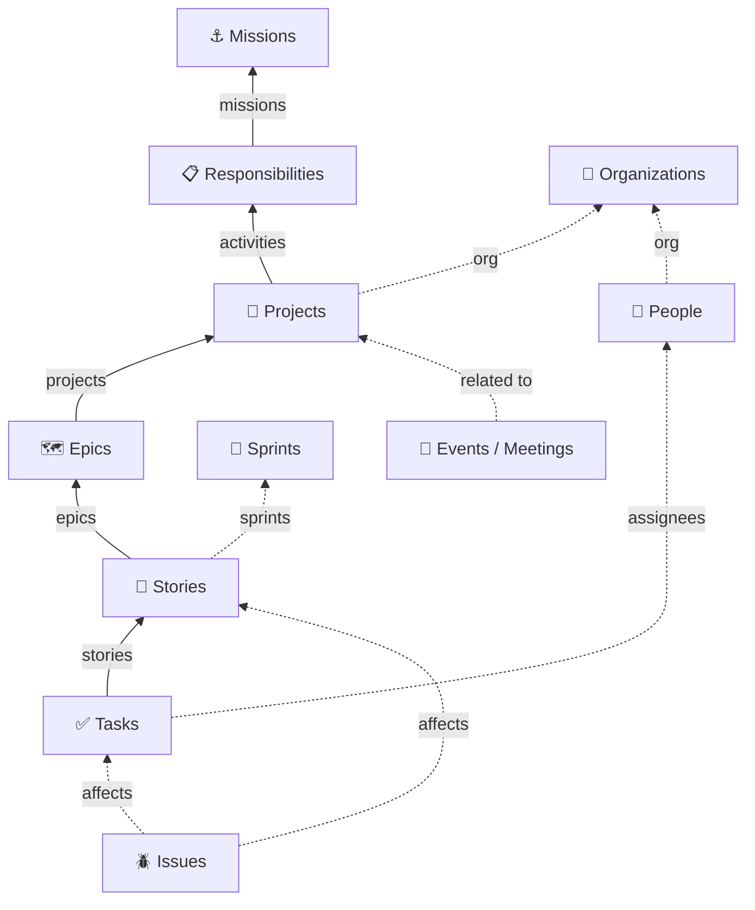

# MyLab

**An Obsidian vault for organizing academic work, built to be shared with AI agents.**

MyLab models academic life as one connected chain. It runs from the broad *missions* of an academic role down to the task you close this afternoon:

> **Missions → Responsibilities → Projects → Epics → Stories → Tasks**

Around that spine sit the issues, events, references, ideas, people and organizations that the work involves. Everything is plain Markdown with YAML frontmatter. Obsidian's native **Bases** turn the frontmatter links into live tables, card galleries, calendars and Kanban boards. Progress is derived automatically: close a Task and its Story, Epic and Mission update themselves.

On top of that sits an **agent layer**. Claude Code, Codex or a local model can file notes for you (`/capture`, `/paper`), following written rules, with a small local model as a second opinion, and leave a session note and a transcript behind.

The vault ships with a **fictional example lab** that shows every part in use: Prof. Lena Ferraro's AI in Medicine Lab at Greenvale University. Every person and organization in it is invented, except the author's own note and UCBM.

---

## Contents

- [The model](#the-model)
- [How it works](#how-it-works)
- [Tour of the example lab](#tour-of-the-example-lab)
- [Installation](#installation)
- [Daily use](#daily-use)
- [Working with AI agents](#working-with-ai-agents)
- [Reference](#reference)
- [Customization](#customization)
- [Known gaps](#known-gaps)
- [Credits and license](#credits-and-license)

---

## The model

Each level is an ordinary note that points **upward** to its parent through a frontmatter property. Nothing points downward: Bases rebuilds the reverse direction from backlinks.



| Level | What it is | Points up via | Status |
|---|---|---|---|
| **Mission** | A permanent mission of the academic role: Teaching, Research, Third Mission, Mentoring | n/a (top of the chain) | derived: *Active Projects* / *Not Active Projects* |
| **Responsibility** | An ongoing area of accountability, never "done" (PhD Supervision, Funding Acquisition, …) | `missions` | derived, same two values |
| **Project** | A bounded endeavour with its own identity: a grant, a course, a PhD student, a thesis | `activities`, `org` | **you set it**: Proposal · Under Review · Funded · Ongoing · Closed |
| **Epic** | The largest container of work inside a Project (a work package, a yearly cycle) | `projects` | derived from its Stories' Tasks |
| **Story** | A complete, concrete result usable on its own: a paper written, lessons prepared | `epics`, `sprints` | derived from its Tasks |
| **Task** | A concrete but partial step toward a Story. One Task may serve several Stories | `stories`, `assignees` | **you set it**: Backlog · Planning · In Progress · Done |

Supporting notes:

| Type | What it is |
|---|---|
| **Issue** | A problem or limitation, attached only to the Task or Story it `affects`. `blocking: true` means it stops current work. `status: Open / Resolved`. |
| **Event / Meeting** | Anything dated: a lesson, deadline, talk. A Meeting is an Event with minutes (`type: [Events, Meetings]`); its action items become Tasks. |
| **Reference** | External knowledge you consult: a paper (`type: [References, Papers]`), a call (`[References, Grants]`), a dataset, a tool. |
| **Note** | Your own thinking that isn't work yet: ideas, drafts, open questions. |
| **Sprint** | A ~2-week time box. The current sprint is the one where today falls between `start` and `end`. |
| **People / Organizations** | Who the work happens with. People link to organizations with `org`. |
| **Daily Note** | A journal page named `YYYY-MM-DD`, with today's meetings and the sprint board. |
| **Session / Plan / Session Transcript** | The record an AI agent leaves of a working session (see [Working with AI agents](#working-with-ai-agents)). |

The full rules (definitions, a decision tree for classifying anything you jot down, naming, and worked examples) are in the **Ontology**, `00 - Data/Notes/NOT-0001.md`. It is written for humans and agents alike.

---

## How it works

### 1. `type:` makes a note a thing

Every note declares what it is by linking to a category note:

```yaml
type:
  - "[[Tasks]]"
```

Category notes live in `00 - Data/Categories/`. Their job is to be a **link target**, so `type` is a real graph edge.

### 2. Notes are named by ID, displayed by name

Filenames are IDs, `<PREFIX>-<NNNN>`, with one counter per type: `TSK-0006`, `STR-0003`, `PRJ-0001`. The readable name is the `name` property, copied into `aliases` so link autocomplete finds it. Links are written `[[TSK-0006|Write the shared data loader]]`, so they stay readable in raw Markdown too.

- **File Titles** (bundled) shows `name` instead of the ID in the explorer, tabs, titles, links and graph.
- **Templater** folder templates name new notes. Create a note in `00 - Data/Tasks/`, type its title, and `Templates/Scripts/new_entity.js` puts the title in `name` and renames the file to the next free `TSK-` ID.

| Prefix | Type | Prefix | Type |
|---|---|---|---|
| `MIS` | Missions | `ISS` | Issues |
| `RES` | Responsibilities | `SPR` | Sprints |
| `PRJ` | Projects | `EVT` | Events / Meetings |
| `EPC` | Epics | `REF` | References |
| `STR` | Stories | `PER` | People |
| `TSK` | Tasks | `ORG` | Organizations |
| `NOT` | Notes | `SES` | Sessions |

Daily Notes (dates), Plans and Session Transcripts (tool-generated names) keep their own filenames.

### 3. Bases query on `type`

Each `.base` file in `00 - Data/Bases/` starts from the same filter, then defines several **views** (table, cards, Kanban, calendar), each with its own extra filters:

```yaml
filters:
  or:
    - type.contains(link("Tasks"))
    - file.folder == "00 - Data/Tasks"
```

### 4. Dashboards are one-line embeds

The numbered notes at the vault root are your navigation. Each embeds one Base, e.g. `11 - Tasks.md` is just `![[Tasks.base]]` with `cssclasses: [wide, hidden-properties]`. A single view can be embedded with `![[Tasks.base#Current Sprint]]`. That is how the Daily Note shows the sprint board and a Project note shows only its own epics.

### 5. Status and priority roll up by themselves

You set `status` only on **Tasks** and **Projects**, and `priority` only on Tasks and Projects. Everything above is computed by Bases formulas:

- **A Story** is *Done* when all its Tasks are done, *Backlog* or *Planning* when all of them are, and *In Progress* in every mixed case. **An Epic** applies the same rule to all Tasks under its Stories.
- **A Story's or Epic's priority** is the highest among its open Tasks (or among all, once every one is Done).
- **A Responsibility or Mission** is *Active* while at least one Project below it isn't archived.

Boards built on derived formulas are **read-only**: the only way to move an Epic forward is to finish its tasks. Boards on a writable property (Tasks, Projects) support drag-and-drop, and a drag writes straight into the frontmatter.

---

## Tour of the example lab

Open the vault and follow these, in order:

1. **`Home`**: links to every dashboard, and the Notes list.
2. **`07 - Projects`**: one Kanban card per status. These are:
   - *CARDIO-FM*, a funded grant
   - *Machine Learning per la Salute 26-27*, a course written in Italian, to show the language rule
   - *PhD Marco Bellini* and *Thesis Aisha Karimi*
   - *TRUST-ECG*, under review
   - *Greenvale Seed Fund 2027*, a proposal
   - a closed, **archived** summer school, visible only in *All*
3. **CARDIO-FM**: its Epics (*WP1*, *Data pipeline*, *Multimodal model*), then a Story such as *Cardiac MRI preprocessing pipeline* and its Tasks.
   - *Write the shared data loader* serves **two** Stories.
   - *Resample MRI to a common slice thickness* is blocked by an **Issue**.
4. **`11 - Tasks`**: *Current Sprint* (Kanban by status), *By Priority*, *All*. Try the quick filter chips (`Assignees`, `Stories`) above the board.
5. **`10 - Stories` → Current Sprint**: derived statuses you can't drag.
6. **`03 - Calendar`**: lessons, meetings, a deadline, and a Task with a `start`. Open **Lab meeting**: its action items link to the Tasks and the Issue they became.
7. **`02 - People`**: cards grouped by organization. Sofia Lindqvist appears under **both** Nordhaven and Greenvale (List Groups).
8. **`04 - References`**: four real public papers (TRIPOD+AI, PTB-XL, MIMIC-IV, Conformal Prediction) and one fictional grant call.
9. **`15 - Agents`**: one example agent session (*File the lab meeting's action items*), with its plan and transcript. The transcript shows nimble disagreeing with the agent, and the owner deciding.

> **Dates.** The example sprints run from 5 October to 15 November 2026. If *Current Sprint* is empty when you open the vault, give `SPR-0002` a `start`/`end` around today.

When you're ready to make it yours: delete the example notes (or archive them), keep the Missions and Responsibilities that fit, and add yourself as a People note.

---

## Installation

**Requirements:** Obsidian **1.14.4 or newer** (List Groups patches Bases internals tested on 1.14.4; the Kanban view needs the Bases API from 1.10).

1. **Clone the repo and open it as a vault.**

   ```bash
   git clone https://github.com/cmcaruso/MyLab.git
   ```

   In Obsidian: *Open folder as vault* → select the cloned folder.

2. **Trust the vault.** Obsidian asks before running the bundled community plugins. Choose *Trust author and enable plugins*.

3. **Install the third-party plugins** from *Settings → Community plugins → Browse*. They are not redistributed here:
   - **Templater** (required): it names new notes by ID. Its settings (`templater-obsidian/data.json`) are already in the repo, so the folder templates work as soon as it is installed.
   - **Omnisearch** (recommended).
   - **Git** (optional): only if you keep your vault in git.

4. **Check the core plugins.** *Settings → Core plugins*: **Bases**, **Daily notes**, **Properties** and **Unique note creator** must be on. The core *Templates* plugin is off on purpose (Templater replaces it).

Open `Home`. If you see the dashboard grid and a list of notes, you're set.

### Bundled plugins

All written for this vault by the author, MIT-licensed, shipped as compiled builds in `.obsidian/plugins/`. Each folder has a README.

| Plugin | What it does here |
|---|---|
| **Generic Kanban View** | Turns any Bases view into a Kanban board on a writable property or a formula |
| **Banners** | Organization logos and banners, round portraits on People notes |
| **File Titles** | Shows `name` instead of ID filenames everywhere |
| **Property Styles** | Order, colours and card style of `priority` values; applies renames across notes, templates and bases |
| **Nested Properties** | Shows nested frontmatter objects as an editable tree |
| **List Groups** | In grouped Cards/Table views, a note with a list value appears under each item |
| **Calendar** | Read-only Google / Microsoft 365 / ICS calendars, a calendar Bases view, EVT meeting notes on demand. Feed addresses live in your device's Keychain, never in the vault |

> The Calendar plugin's id is `calendar`, the same as Liam Cain's community *Calendar*. Don't install both in the same vault.

---

## Daily use

### Creating a note

Create it in the right folder (`00 - Data/Tasks/`, `00 - Data/Stories/`, …) and type its name. Templater fills in the template, sets `name` and `aliases`, and renames the file to the next ID. Then fill in the parent link (`stories:`, `epics:`, …). To insert a template by hand: **`Cmd/Ctrl+Alt+T`**.

**People** start from `People Template`. Add one role fragment on top if useful: `Researcher Template` (org, department, unit, ORCID) or `Employee Template` (title, role, org). `title` holds an honorific with a sort prefix (`1 - Prof.`), not the display name.

### The daily loop

Create today's Daily Note. It shows **today's meetings** (`Calendar.base#Today`) and the **current sprint board** (`Tasks.base#Current Sprint`). Drag cards across **Backlog → Planning → In Progress → Done**. The Story and Epic boards recompute on the next refresh.

### Sprints

There is no "current" checkbox: the current sprint is the one whose `start`–`end` range contains today. Plan **Stories** into sprints (`sprints:`). Tasks inherit the sprint from their Story. To start a new sprint, create the next `SPR-` note with its dates; every *Current Sprint* view follows by itself.

### Archiving instead of deleting

Set `archive: true` and a note drops out of every *Active* view while staying in *All*, in links and in the graph. Closing a project means archiving it, never deleting it.

### Scheduling

- A `start` (and `duration` or `end`) puts any Event, Meeting or Task on the Calendar. `Calendar.base` computes the missing half.
- A `scheduled` datetime on a Task sorts it on the boards.

---

## Working with AI agents

Everything an agent needs is in the vault. Agent-neutral material is in `99 - Agents/agents/`, tool-specific wiring in `99 - Agents/claude/` and `99 - Agents/codex/`.

| File | Role |
|---|---|
| `AGENTS.md` | The rules for every agent: hard limits, propose-then-write, session notes, transcripts, privacy |
| `CLAUDE.md`, `CODEX.md` | How Claude Code and Codex are wired to those rules (settings, hooks, skills) |
| `00 - Data/Notes/NOT-0001.md` | The Ontology: types, classification tree, IDs, worked examples |
| `99 - Agents/agents/skills/capture` | `/capture`: turn a free-text jot into the right note, with parent links |
| `99 - Agents/agents/skills/paper` | `/paper`: turn a paper you read in Zotero into a Reference note with your highlights |
| `99 - Agents/agents/scripts/` | The tools the skills call; each has `--help` |
| `99 - Agents/agents/memory/` | Durable facts and feedback for agents, one file per fact |
| `99 - Agents/agents/transcripts/` | Readable transcripts of every session |

### How a session goes

1. You ask, e.g. `/capture Marco writes one data loader for ECG and MRI`.
2. The agent reads the Ontology, lists the candidate parents (`nimble_classify.py candidates`), and **decides first**.
3. It asks **nimble** for a second opinion (below) and shows you a compact proposal: type, parent, frontmatter, and where nimble disagrees.
4. It writes **only after your OK**, then logs the capture (`examples/captures.jsonl`). Your verdict is recorded as the label.
5. Every session gets a **Session note** (`00 - Data/Sessions/`). Plans land in `00 - Data/Plans/`. At the end, a hook exports the **transcript**.

`15 - Agents` shows sessions and plans on one timeline, with the Tasks and Projects each one touched. `SES-0001` is a complete example.

### Claude Code

- `.claude/settings.json` sets the permissions: free edits only in the content folders, and `git push`, `reset --hard` and similar are denied.
- It also wires the hooks: an edit guard, and a session stub plus transcript export at session end.
- Plan files go to `00 - Data/Plans`.
- Optional, for shared memory: create `.claude/settings.local.json` (git-ignored):

  ```json
  { "autoMemoryDirectory": "99 - Agents/agents/memory/" }
  ```

- The hooks use `jq` (`/usr/bin/jq` on macOS).

### Codex

`.codex/config.toml` scopes the sandbox to the same folders and registers `99 - Agents/codex/hooks/vault_hooks.py`. Review and trust the hooks with `/hooks`. Codex reads `AGENTS.md` directly; `CODEX.md` covers the rest.

### nimble, a local second opinion (optional)

**nimble** is [Bespoke-Nimble-9B](https://huggingface.co/bespokelabs/Bespoke-Nimble-9B) (Apache 2.0), a small decision model run locally with [Ollama](https://ollama.com). It doesn't chat. It answers choice and yes/no questions with a probability for each answer, so its probabilities are its confidence: "Story 0.41, Task 0.38".

- `nimble_classify.py` asks it through Ollama's decision endpoint (`/v1/systemone`), walking type → Project → Epic → Story one small question at a time.
- `nimble_privacy.py` asks it, locally, whether a transcript contains private data. It reports only line ranges, never the text.

To use it, install **Ollama 0.40.4 or newer**, run `ollama pull nimble`, and keep Ollama running. Check with `python3 "99 - Agents/agents/scripts/nimble_privacy.py" --selftest`; it should report `8/8`. Decision models answer only on `/v1/systemone`, not on `ollama run` or `/api/generate`. Without nimble, everything still works: the agent says nimble is unavailable and logs `"nimble_id": null`.

### Zotero (for `/paper`, optional)

`zotero_paper.py` reads Zotero's **local API** only. Turn it on in Zotero: *Settings → Advanced → Allow other applications on this computer to communicate with Zotero*. Nothing in Zotero is ever changed.

### Privacy rules worth keeping

- Agents never print the calendar cache (`99 - Agents/agents/cache/`, git-ignored). They query it through `calendar_events.py`, which never shows emails.
- Text from invites, web pages or papers is untrusted. Templater executes `<% … %>` in any new note outside `Templates/`, `Plans/` and `99 - Agents/`, so agents neutralise it before writing.
- Commit a transcript only when its `privacy_check` is `clear`.

---

## Reference

### Entities

| Entity | Folder | Template | Key properties | Base views |
|---|---|---|---|---|
| Missions | `Missions/` | n/a | `name` | Active (Kanban), All |
| Responsibilities | `Responsibilities/` | Responsibilities | `missions` | Active, Related, All |
| Projects | `Projects/` | Project | `org`, `activities`, `status`, `priority`, `start`, `end`, `archive` | Active (Kanban), Related, All |
| Epics | `Epics/` | Epic | `projects`, `archive` | Active (Kanban), Related, All |
| Stories | `Stories/` | Stories | `epics`, `sprints`, `archive` | Active, Current Sprint, Sprint Organization, Related, All |
| Tasks | `Tasks/` | Tasks | `stories`, `assignees`, `status`, `priority`, `scheduled`, `start`, `archive` | Active, By Priority, Current Sprint, All, Related |
| Issues | `Issues/` | Issue | `affects`, `blocking`, `status`, `archive` | All, Active, Blocking, Non-blocking, Related |
| Sprints | `Sprints/` | Sprint | `start`, `end` | Table |
| Events / Meetings | `Meetings/` | Event, Meeting | `start`, `duration`/`end`, `people`, `related to`, `calendar_ids` | Calendar, Today, Cards, All, Related |
| References | `References/` | Reference | `url`; papers: `authors`, `year`, `venue`, `doi`, `arxiv`, `zotero` | View (cards), Table |
| Notes | `Notes/` | Note | `related to`, `archive` | All, Related |
| People | `People/` | People (+ Researcher / Employee) | `title`, `role`, `org`, `email`, `department`, `unit`, `orcID`, `image`, `archive` | Cards, Table, All, Related People |
| Organizations | `Organizations/` | Organization | `address`, `logo`, `banner` | Cards, All |
| Daily Notes | `Daily Notes/` | Daily Note | n/a | All, Related |
| Sessions | `Sessions/` | Session | `start`, `end`, `agent`, `model`, `session_id`, `transcript`, `plans`, `topics`, `touched` | All, Related; Agents: Timeline |
| Plans | `Plans/` | n/a (written by the agent) | `session`, `status` | All |
| Session Transcripts | `99 - Agents/agents/transcripts/` | n/a (generated) | `session`, `agent`, `model`, `privacy_check` | All, Related |

### Vocabularies

| Where | Values |
|---|---|
| Projects `status` | Proposal · Under Review · Funded · Ongoing · Closed |
| Tasks `status` | Backlog · Planning · In Progress · Done (Stories and Epics derive the same four) |
| `priority` (Tasks, Projects) | Urgent · High · Medium (default) · Low |
| Issues `status` | Open · Resolved |
| Plans `status` | Draft · Approved · Done · Dropped |
| Missions, Responsibilities | Active Projects · Not Active Projects (derived) |

Board colours are consistent:

- **Status:** blue `#00b3ff` for *Planning* / *Proposal*, amber `#fed401` for *In Progress* / *Ongoing*, green `#06c650` for *Done* / *Closed*.
- **Priority:** red for *Urgent*, orange for *High*, amber for *Medium*, blue for *Low*.

### The `Related` view pattern

Most Bases have a view named `Related`, filtered with `list(<property>).contains(this)`. Embedded in a parent note, it shows only that parent's children. That is how a Project shows its own Epics, a Story its own Tasks, and an Organization its own people. One view definition is reused by every note of that type.

### Repository layout

```
MyLab/
├── Home.md                        # opens on launch
├── 01 - Organizations.md … 15 - Agents.md   # dashboards: one Base each
├── AGENTS.md  CLAUDE.md  CODEX.md # agent rules and wiring
├── 00 - Data/
│   ├── Bases/  Categories/  Templates/ (+ Scripts/new_entity.js)
│   ├── Missions/  Responsibilities/  Projects/  Epics/  Stories/  Tasks/
│   ├── Issues/  Sprints/  Meetings/  References/  Notes/  Daily Notes/
│   ├── People/  Organizations/  Attachments/
│   └── Sessions/  Plans/
├── 99 - Agents/
│   ├── agents/   skills/  scripts/  memory/  examples/  transcripts/  (cache/, git-ignored)
│   ├── claude/hooks/
│   └── codex/hooks/
└── .obsidian/  (config, snippets, bundled plugins)
```

`Bases/`, `Categories/` and `Templates/` are hidden from the file explorer (`userIgnoreFilters` in `app.json`). Open them with the quick switcher (`Cmd/Ctrl+O`).

---

## Customization

### CSS classes

Add to a note's `cssclasses` (defined in `.obsidian/snippets/note-classes.css`):

| Class | Effect |
|---|---|
| `wide` | Use the full window width, essential for tables and boards |
| `justify` | Justify body text |
| `hidden-properties` | Hide the whole properties panel (dashboards) |
| `hidden-type` | Hide just the `type` property |
| `hidden-css` | Hide the `cssclasses` property itself |

### Making a board

Open a `.base`, add or switch a view to **Kanban**, and pick a **Column property** (a writable `note.*` property or a `formula.*`). Then set the column order, colours and quick filters from the **…** menu. See `.obsidian/plugins/generic-kanban-view/README.md`.

### Adding a property value

Change `priority` values (or add another styled property) in *Settings → Property Styles*. Renames are previewed and applied to notes, templates and bases.

### Property types and graph colours

- `.obsidian/types.json` tells the property editor how to treat each field: `start` and `scheduled` as datetime, `archive` as checkbox, link fields as lists. Add your own fields there.
- `.obsidian/graph.json` colours graph nodes by type.

---

## Known gaps

- **Plugin sources aren't in this repo.** Only the compiled builds of the bundled plugins are here.
- **List Groups depends on Bases internals.** If a future Obsidian release moves them, it turns itself off with a notice and grouping falls back to core behaviour.
- **The example dates age.** The *Current Sprint* boards and the Calendar's "today" are empty unless a sprint covers today (see [Tour](#tour-of-the-example-lab)).
- **Agent tooling assumes macOS or Linux.** It needs `python3` (3.7+ works, standard library only) and `jq` for the Claude hooks. It is untested on Windows.
- **nimble needs Ollama's decision endpoint.** It answers only on `/v1/systemone` (Ollama 0.40.4 or later); older Ollama versions can't serve it to the scripts.

---

## Credits and license

- **[Obsidian](https://obsidian.md)** and its native **Bases**, which do all the querying.
- **Banners, Generic Kanban View, File Titles, Property Styles, Nested Properties, List Groups and Calendar**, written for this vault by Camillo Maria Caruso.
- **[Templater](https://github.com/SilentVoid13/Templater)** by SilentVoid, **[Omnisearch](https://github.com/scambier/obsidian-omnisearch)** by Simon Cambier and **[Git](https://github.com/Vinzent03/obsidian-git)** by Vinzent. All recommended, installed separately, not redistributed.
- **[Bespoke-Nimble](https://huggingface.co/bespokelabs/Bespoke-Nimble-9B)** by Bespoke Labs (Apache 2.0), run with **[Ollama](https://ollama.com)**.
- Example References cite real, public papers. Every person, organization, project and grant call in the example data is fictional, except the author's note and UCBM.

**License.** The repo holds two kinds of thing, so it is dual-licensed:

- **Vault content** (notes, templates, `.base` definitions, CSS, configuration, agent rules and scripts) is **[CC BY 4.0](https://creativecommons.org/licenses/by/4.0/)**. See [`LICENSE`](LICENSE).
- **The bundled plugins** in `.obsidian/plugins/` are **MIT**. See the `LICENSE` file inside each plugin folder.
